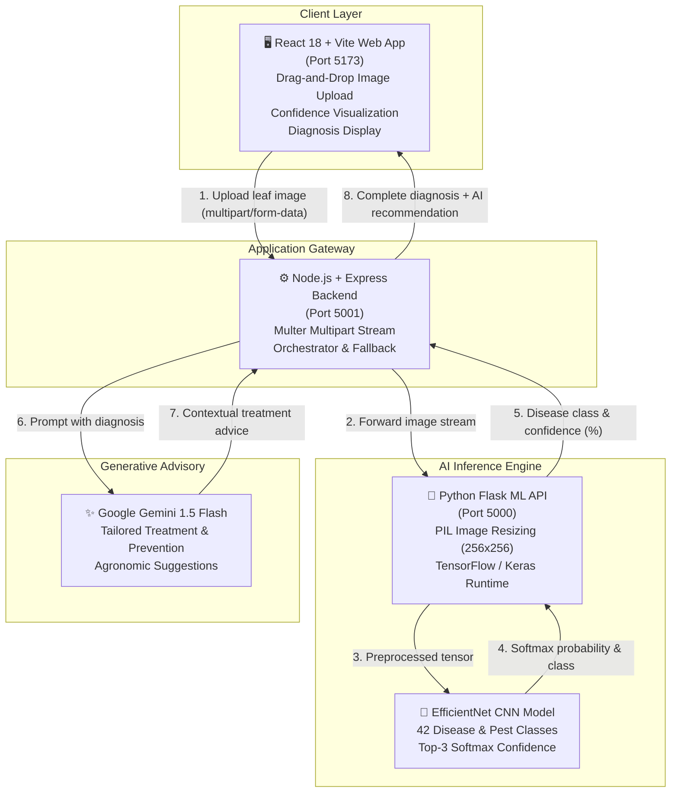

# 🌱 CropHealth AI — CNN Crop Disease Detection & Advisory System

[](https://react.dev/)
[](https://nodejs.org/)
[](https://flask.palletsprojects.com/)
[](https://tensorflow.org/)
[](https://ai.google.dev/)

An end-to-end full-stack agricultural AI application that diagnoses **42 crop diseases and pests** across major crops (Cotton, Rice, Maize, Wheat, and Sugarcane) using an **EfficientNet Convolutional Neural Network (CNN)** and provides farmers with **instant, actionable treatment recommendations powered by Google Gemini AI**.

---

## 🏛️ System Architecture

The application adopts a decoupled, microservice-inspired three-tier architecture with an external Generative AI advisory layer:



### Architecture Breakdown

1. **Frontend (Presentation Tier)**:
   - Built with **React 18** and bundled with **Vite**.
   - Features a clean, accessible UI with drag-and-drop leaf upload, image preview, progress state, and responsive visual breakdown of confidence scores.
2. **Node.js Gateway (Orchestration Tier)**:
   - Express server running on port `5001`.
   - Manages file uploads via `multer` in-memory storage, proxies inference payloads to the Python ML engine, and interfaces with the **Google Generative AI SDK**.
   - Generates contextual treatment recommendations for diseased leaves and maintenance tips for healthy crops.
3. **Python ML Engine (Inference Tier)**:
   - Lightweight Flask service on port `5000`.
   - Preprocesses input images to 256×256 RGB tensors, evaluates them against the pre-trained `efficientnet_best_model.keras` CNN, and computes top predictions with confidence percentages.

---

## 🌾 Supported Crops & 42 Disease Classes

The model is trained to recognize **42 diagnostic categories** across 5 vital crops:

| Crop | Detectable Conditions & Pests |
| :--- | :--- |
| **Cotton** | American Bollworm, Anthracnose, Aphid, Bacterial Blight, Bollworm, Healthy Cotton, Mealy Bug, Pink Bollworm, Red Cotton Bug, Thrips, Whitefly |
| **Rice** | Bacterial Blight, Brownspot, Leaf Smut, Rice Blast, Tungro |
| **Wheat** | Aphid, Black Rust, Brown Leaf Rust, Flag Smut, Healthy Wheat, Leaf Blight, Mite, Powdery Mildew, Scab, Stem Fly, Yellow Rust |
| **Maize** | Common Rust, Ear Rot, Fall Armyworm, Gray Leaf Spot, Healthy Maize, Stem Borer |
| **Sugarcane** | Healthy Sugarcane, Mosaic, Red Rot, Red Rust, Yellow Rust |
| **General** | Armyworm, Wilt |

---

## 📂 Project Structure

```
CNNcropdiseasedetection/
├── frontend/                     # React 18 + Vite frontend
│   ├── src/
│   │   ├── App.jsx               # Main UI component & state management
│   │   ├── App.css               # Clean responsive styling & animations
│   │   └── main.jsx              # React DOM entrypoint
│   ├── index.html                # HTML template
│   ├── package.json              # Frontend scripts & dependencies
│   └── vite.config.js            # Vite configuration
│
├── backend/                      # Node.js + Express API gateway
│   ├── server.js                 # Express server & Gemini LLM integration
│   ├── package.json              # Node dependencies
│   └── .env.example              # Environment variables template
│
├── ml-api/                       # Python Flask inference service
│   ├── app.py                    # Flask server & model inference handler
│   ├── efficientnet_best_model.keras # Pre-trained EfficientNet CNN model
│   ├── class_names.json          # 42 class index mappings
│   └── requirements.txt          # Python dependencies
│
├── .gitignore                    # Git ignore rules
└── README.md                     # Project documentation
```

---

## 🚀 Quick Start Guide

### Prerequisites
- **Node.js** (v18+) & **npm**
- **Python** (v3.9 - v3.11 recommended)
- **Google Gemini API Key** ([Get free key from Google AI Studio](https://aistudio.google.com/))

---

### Step 1: Start the Python ML Service

```bash
cd ml-api

# Create & activate a virtual environment (optional but recommended)
python -m venv venv
# Windows:
.\venv\Scripts\activate
# Linux/macOS:
source venv/bin/activate

# Install dependencies
pip install -r requirements.txt

# Run the Flask inference server
python app.py
```
> ML API starts at: `http://127.0.0.1:5000`

---

### Step 2: Start the Node.js Backend Gateway

Open a second terminal:

```bash
cd backend

# Install dependencies
npm install

# Configure environment variables
copy .env.example .env     # On Windows (or 'cp .env.example .env' on Linux/macOS)
```

Edit `backend/.env` with your API key:
```env
GEMINI_API_KEY=your_gemini_api_key_here
PORT=5001
ML_API_URL=http://127.0.0.1:5000/predict
```

Start the backend:
```bash
npm run dev    # Or: npm start
```
> Backend starts at: `http://localhost:5001`

---

### Step 3: Start the React Frontend

Open a third terminal:

```bash
cd frontend

# Install dependencies
npm install

# Run Vite dev server
npm run dev
```
> Open your browser at: `http://localhost:5173`

---

## 📡 API Reference

### 1. Backend Gateway Prediction
**Endpoint**: `POST http://localhost:5001/predict`  
**Content-Type**: `multipart/form-data`  
**Body**: `file` (Image binary: JPG, PNG, WebP)

**Sample Response**:
```json
{
  "success": true,
  "disease": "Wheat - Yellow Rust",
  "confidence": 98.42,
  "status": "disease",
  "recommendation": "Yellow rust requires immediate action. Apply approved triazole or strobilurin-based fungicides such as propiconazole or tebuconazole. Ensure field drainage and avoid excessive nitrogen fertilization."
}
```

### 2. ML Engine Direct Prediction
**Endpoint**: `POST http://127.0.0.1:5000/predict`  
**Content-Type**: `multipart/form-data`  
**Body**: `file` (Image binary)

**Sample Response**:
```json
{
  "success": true,
  "disease": "Wheat___Yellow_Rust",
  "confidence": 98.42,
  "top_predictions": [
    { "disease": "Wheat___Yellow_Rust", "confidence": 98.42 },
    { "disease": "Wheat leaf blight", "confidence": 1.15 },
    { "disease": "Wheat powdery mildew", "confidence": 0.28 }
  ]
}
```

---

## 🛡️ Error Handling & Resiliency

- **Graceful ML Fallback**: If the Python inference engine is temporarily unreachable, the Node.js backend safely falls back to a simulated analysis mode with an informative notice rather than crashing.
- **Input Validation**: Rejects non-image payloads and empty requests with clear 400 Bad Request responses.
- **Secure Credentials**: All API keys are loaded strictly from `.env` files and excluded from version control via `.gitignore`.

---

## 👨‍💻 Author

**Aarkesh Sharma**
- GitHub: [@AarkeshSharma79](https://github.com/AarkeshSharma79)
- Project Repository: [CNNcropdiseasedetection](https://github.com/AarkeshSharma79/CNNcropdiseasedetection)

---

## ⭐ Show Your Support

If you find this project helpful, please consider giving it a ⭐ on GitHub!
